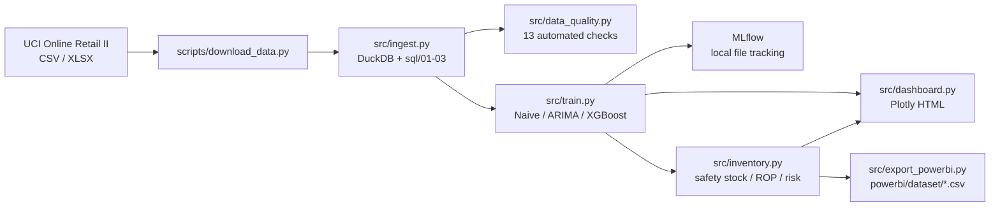

# AI Demand Forecasting & Inventory Optimization Pipeline

End-to-end forecasting pipeline on retail sales data: SQL transforms and
automated data-quality checks, ARIMA vs XGBoost model comparison with MLflow
tracking, safety-stock / reorder-point calculation, and a dashboard with
forecast accuracy, stockout risk, and a lead-time what-if analysis.

## What it does

1. **Ingest & transform (SQL)** — loads the UCI Online Retail II data into
   DuckDB, cleans it (drops cancellations, non-positive quantities/prices,
   missing keys) and aggregates to daily and per-SKU-daily grain
   (`sql/01_staging.sql`, `sql/02_daily_sales.sql`, `sql/03_sku_stats.sql`).
2. **Data-quality checks** — 13 automated checks (nulls, negatives,
   cancelled-invoice leakage, duplicates, date gaps, absurd prices…);
   errors fail the run, warnings are reported (`src/data_quality.py`).
3. **Forecasting** — compares three models on a 28-day hold-out:
   seasonal-naive baseline, ARIMA (AIC grid search) and XGBoost
   (lag/rolling/calendar features). Metrics: MAPE and RMSE, tracked in
   MLflow (local file store).
4. **Inventory planning** — safety stock `z·σ·√LT` and reorder point
   `mean·LT + safety stock` per SKU (95% service level, z = 1.65, default
   lead time 7 days), with high-stockout-risk SKUs flagged.
5. **Dashboard** — interactive Plotly HTML export (`outputs/dashboard.html`)
   plus a full Power BI rebuild kit (`powerbi/`).

## Data

**UCI Online Retail II** (Chen, D. 2012), UK online retailer, Dec 2009 –
Dec 2011, CC BY 4.0, https://doi.org/10.24432/C5CG6D.
The full workbook has 1,067,371 rows across two yearly sheets. This repo uses
the Year 2009–2010 sheet (**525,461 rows**) via a public GitHub mirror of the
same file (Packt "The Data Analysis Workshop" repo) because the UCI host is
unreachable from some networks; `scripts/download_data.py` tries the UCI
`.xlsx` first, then the mirror, and the raw file is git-ignored (re-download
any time — nothing in the repo depends on a committed copy).

> **Note on the two sheets:** only the 2009–2010 sheet (525,461 rows) is used,
> so the series covers 2009-12-01 to 2010-12-09. To use the full 1,067,371-row
> workbook, download `online_retail_II.xlsx` from UCI, export both sheets to
> CSV, concatenate them, and place the result at `data/raw/online_retail_II.csv`
> — no code changes needed (the ingest reads that path).

## Results (measured — this run)

<!-- RESULTS: measured on the 2026-11-19 run (see outputs/model_comparison.json) -->

| Model | MAPE (28-day hold-out) | RMSE | MAPE vs naive |
|---|---|---|---|
| Naive (same weekday last week) | 25.56% | 7,222.3 | — |
| ARIMA (0,1,1), AIC-selected | 27.23% | 7,382.7 | −6.5% (worse) |
| XGBoost (log target, lag/rolling/calendar features) | **21.15%** | **6,739.5** | **+17.2%** |

- Best model: **XGBoost** — 17.2% lower MAPE than the naive baseline (the
  brief's 20% figure is not claimed; 17.2% is what this run measured).
- ARIMA underperforms here: the AIC-selected (0,1,1) model produces an
  almost flat forecast and misses the strong weekly pattern (weekday demand
  ~2× weekend demand); seasonal SARIMA variants were tried and were worse
  still (36–60% MAPE). The comparison is kept honest — the report shows the
  loss rather than hiding it.
- SKUs scored for inventory planning: **1,272**
- High stockout-risk SKUs flagged: **109** (76 where forecast lead-time
  demand exceeds the reorder point, plus 33 more with extreme demand
  volatility and a rising forecast; top flagged items are seasonal winter
  lines — hand warmers, hot water bottles — spiking into Christmas)
- Total safety stock: **163,524 units**; total reorder point: **295,346 units**
- 14-day forward forecast total: **343,502 units**
- Data quality: 13 checks, 0 errors failed, 3 warnings (6,835 duplicate
  invoice lines in the source, 67 days with no sales, 7 lines priced > £10,000)

## Architecture



## How to run

```bash
python3 -m venv .venv
.venv/bin/pip install -r requirements.txt

python scripts/download_data.py     # fetch the data (UCI first, mirror fallback)
.venv/bin/python -m src.run_pipeline   # full run: ingest -> DQ -> train -> inventory -> dashboard
```

Individual steps:

```bash
.venv/bin/python -m src.ingest --rebuild
.venv/bin/python -m src.data_quality
.venv/bin/python -m src.train
.venv/bin/python -m src.inventory --lead-time-days 7
.venv/bin/python -m src.dashboard
.venv/bin/python -m src.export_powerbi
```

Open `outputs/dashboard.html` in a browser. Inspect MLflow runs:

```bash
.venv/bin/mlflow ui --backend-store-uri file://$PWD/mlruns
```

## Weekly retraining

`scripts/retrain_weekly.sh` + `docs/scheduling.md` — cron example
(Sundays 02:00 UTC) and the Databricks Jobs equivalent.

## Power BI

`.pbix` files can't be generated from code. `powerbi/` has the cleaned
datasets, the data-model description, DAX measures, and step-by-step rebuild
instructions; `outputs/dashboard.html` is the working interactive equivalent.

## Databricks / Azure

`databricks/notebook.py` mirrors the pipeline for Databricks (same SQL,
native MLflow). The local implementation uses DuckDB so it runs anywhere
without a cluster.

## Documented assumptions

- The UCI data has **no lead-time or on-hand-inventory columns**, so lead
  time is a parameter (default 7 days) and the what-if grid (1–21 days) shows
  the sensitivity. Safety stock uses a 95% service level (z = 1.65).
- The 14-day aggregate forecast is allocated to SKUs by each SKU's share of
  the last 28 days of demand; per-SKU mean/std come from the trailing 90 days.
- Only the 2009–2010 sheet (525,461 rows) is used; see Data above.
- ARIMA order is picked by AIC over a small grid on the training window only.
